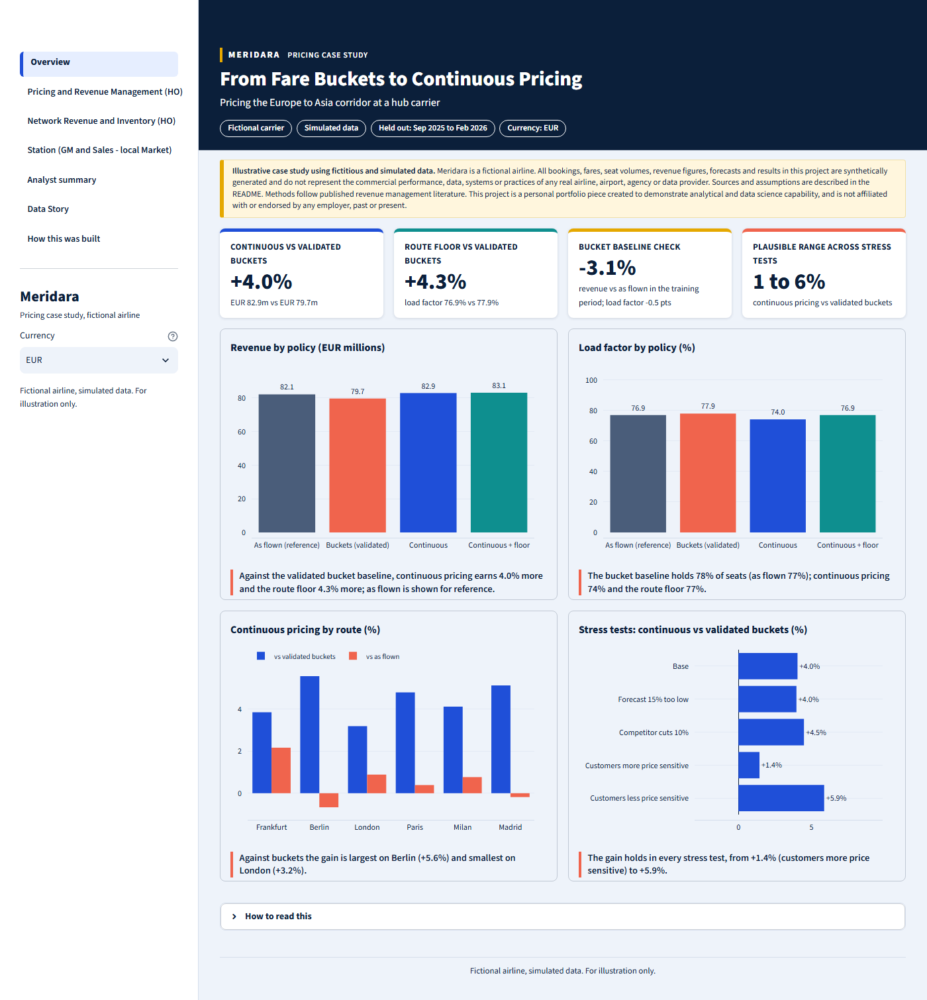
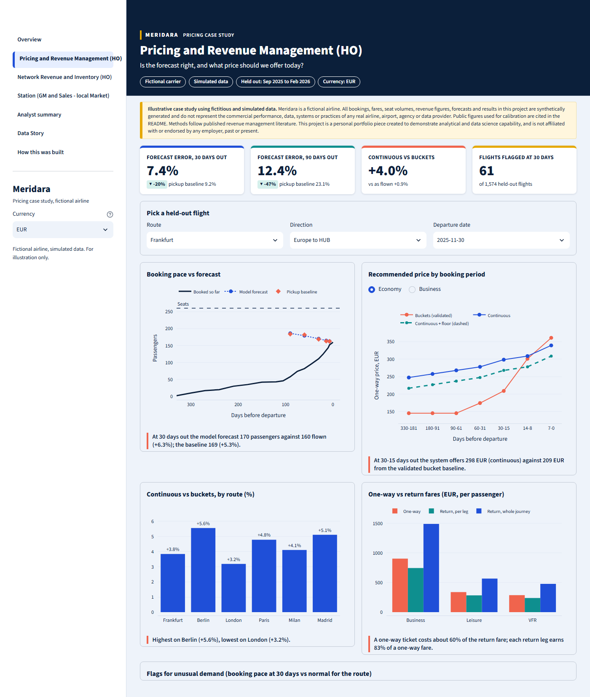
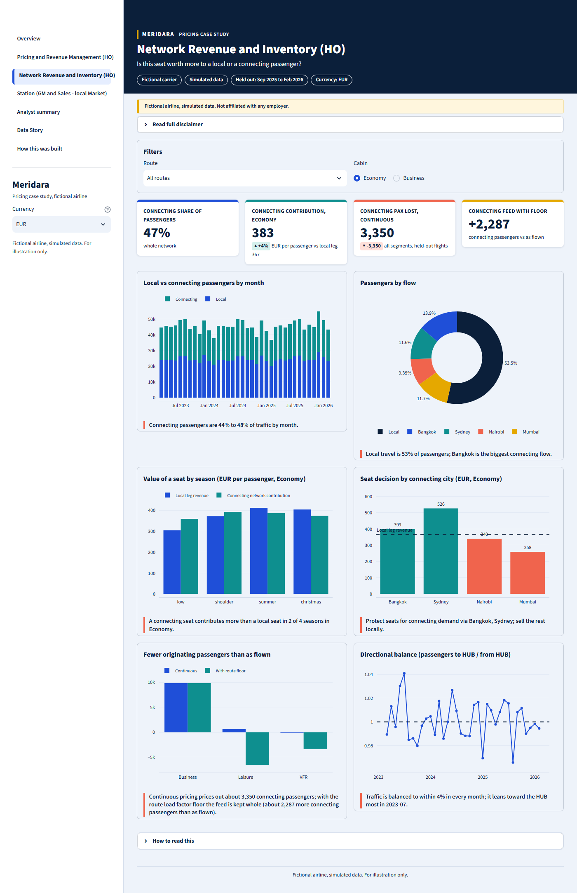
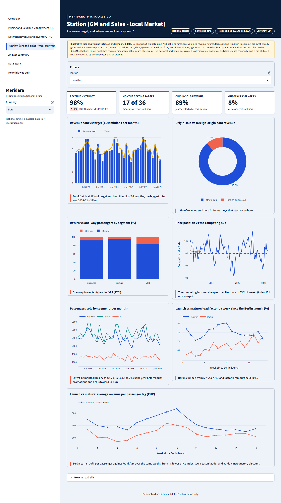
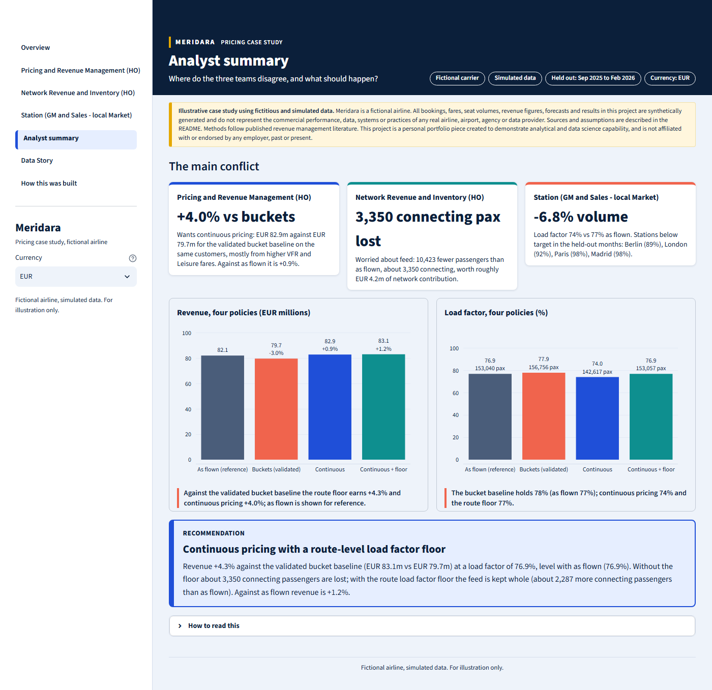
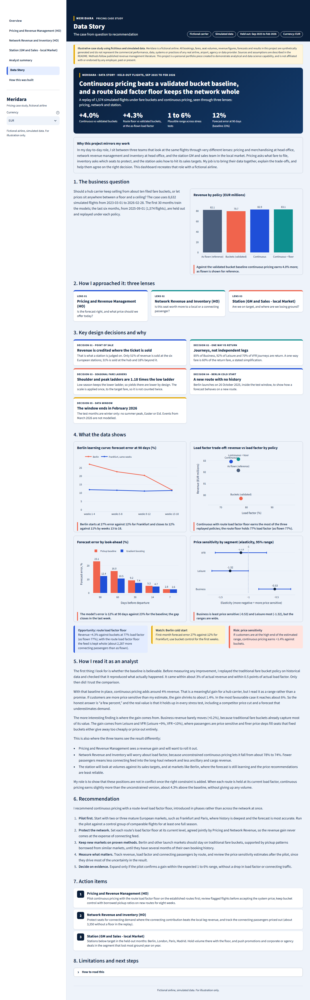

# From Fare Buckets to Continuous Pricing

Pricing the Europe to Asia corridor at a hub carrier.

> **Illustrative case study using fictitious and simulated data.** Meridara is a fictional airline. All bookings, fares, seat volumes, revenue figures, forecasts and results in this project are synthetically generated and do not represent the commercial performance, data, systems or practices of any real airline, airport, agency or data provider. Public figures used for calibration are cited in the README. Methods follow published revenue management literature. This project is a personal portfolio piece created to demonstrate analytical and data science capability, and is not affiliated with or endorsed by any employer, past or present.

## The business problem

Most airlines sell each flight from about ten filed fare buckets and open or close them as a flight fills. Meridara, a fictional hub carrier connecting six European cities with Asia, Africa and Australia, is asking whether letting prices sit anywhere between a floor and a ceiling, re-chosen as demand unfolds, would earn more. Pricing, network revenue management and the local stations each see the answer through a different lens, so the project replays six months of held-out flights under both policies and shows where those lenses agree and where they conflict.

## Live app

**Live link: coming soon** (to be added once the app is deployed).

## Headline result

The bucket policy was calibrated on the training period until a replay of it reproduced what actually happened, then compared with continuous pricing on the six held-out months (September 2025 to February 2026, 1,574 flights, same simulated customers and same rules).

| Policy | Revenue (m EUR) | Load factor | vs validated buckets |
| --- | --- | --- | --- |
| As flown (reference) | 82.1 | 76.9% | |
| Validated fare buckets | 79.7 | 77.9% | |
| Continuous pricing | 82.9 | 74.0% | **+4.0%** |
| Continuous pricing with a route load factor floor | 83.1 | 76.9% | **+4.3%** |

- **The baseline is believable.** The calibrated bucket replay lands within 3.1% of as-flown revenue and 0.5 load factor points on the training period (3.0% and 1.0 points on the held-out months, with settings unchanged).
- **Read it as a range, not a promise.** If customers are more price sensitive than estimated, the gain shrinks to about 1.4%; in the most favourable stress test it reaches about 5.9%. It stays positive in every stress test, including a competitor price cut and a forecast that underestimates demand.
- **The gain comes from Leisure and VFR** (+9% and +10% against buckets). Business barely moves (+0.2%).
- **The trade-off is load factor.** Unconstrained continuous pricing lets load factor fall from about 78% to 74% and prices out roughly 3,350 connecting passengers. Holding each route at its current load factor keeps the feed whole and earns slightly more.
- **The recommendation** is continuous pricing with a route-level load factor floor, piloted on mature routes before any wider rollout, with new routes such as Berlin kept on proven methods until they have their own booking history.

## What each page shows

| Page | Question it answers | What is on it |
| --- | --- | --- |
| Overview | What is the headline? | Four KPIs, revenue and load factor by policy, gain by route, stress tests. |
| Pricing and Revenue Management (HO) | Is the forecast right, and what price should we offer? | Booking pace against the forecast for a chosen flight, recommended price by booking period, continuous pricing against buckets by route, one-way against return fares, and flags for unusual demand. |
| Network Revenue and Inventory (HO) | Is this seat worth more to a local or a connecting passenger? | Local against connecting traffic, seat value by season and connecting city, connecting feed lost and recovered by the load factor floor, directional balance. |
| Station (GM and Sales - local Market) | Are we on target, and where are we losing ground? | Revenue sold at each station's point of sale against budget, origin-sold against foreign-origin-sold revenue, passenger mix by segment and trip type, price position against the competing hub, and Berlin's launch weeks compared with mature routes. |
| Analyst summary | Where do the three teams disagree, and what should happen? | The conflict in three cards, four policies side by side, the recommendation. |
| Data Story | The case from question to recommendation | Eight sections from the business question to limitations. |
| How this was built | How, with what, from what data? | Design approach, tools, data sources, how to reproduce it. |

A currency selector in the sidebar converts every figure (EUR, GBP, USD, AUD, AED) at the monthly average rate of each flight's departure month.

### Screenshots













## Method in plain language

1. **Simulate the airline.** A script with a fixed random seed generates 36 months of departures (March 2023 to February 2026) for six European stations, one hub and four beyond-hub cities: schedules, seasons and events (Easter, Eid, Diwali), one-way and return journeys, three passenger segments, fare ladders, promotions, a competitor price index, monthly exchange rates and a new route (Berlin) that launches on 26 October 2025. Fares drift up 3% a year, and station revenue targets are budgets set in advance, with no information from the month being judged. The first 30 months train the models and the last 6 are held out.
2. **Forecast demand.** A gradient boosting model predicts final passengers per flight and segment at 90, 60, 30, 14 and 7 days before departure, using only bookings made by then. It is compared with the usual historical-pickup baseline on the held-out months. At 90 days, forecast error is 12.4% against 23.1% for the baseline. Berlin has no history, so the model scores it from route characteristics, and its error is shown learning over its first weeks.
3. **Measure price sensitivity.** A Poisson regression on random promotions estimates how demand responds to price, by segment, with standard errors clustered by week. Elasticities are about -0.53 for Business, -1.32 for Leisure and -1.13 for VFR in the low-season sample used for the replay.
4. **Replay the flights.** Each held-out flight gets simulated customers with a willingness to pay (lognormal, spread assumed at 0.45, centred so demand responds as estimated, rising towards departure). Three policies price to the same customers: fare buckets (EMSR-b with advance-purchase rules), continuous pricing (a price re-chosen each booking period to maximise expected revenue) and continuous pricing with a route-level load factor floor. Five scenarios stress the result: base, a forecast 15% too low, a competitor cutting prices 10%, and customers more or less price sensitive than estimated.
5. **Validate the baseline first.** The four free settings of the bucket policy are searched on the training period until its replay reproduces as-flown revenue and load factor, then checked unchanged on the held-out months. Only then are the other policies compared with it.

## Data and assumptions

All data is generated by [`src/generate_data.py`](src/generate_data.py) and stored in `data/meridara.db` (SQLite) with CSV copies of the reference tables; model outputs are in `data/results.db`. The big bookings CSV is rebuilt from the fixed seed and is not committed.

- [`docs/assumptions.md`](docs/assumptions.md): every generator input and modelling choice, with the reasoning.
- [`docs/data_dictionary.md`](docs/data_dictionary.md): every table and column.
- [`docs/model_results.md`](docs/model_results.md): forecast, sensitivity and replay results in full.

**Sources.** Assumption ranges (load factors, fares, segment mix, booking curves) are illustrative and based on the author's industry experience and typical published ranges. Exchange rates use the European Central Bank's euro reference rates (ECB Data Portal, series EXR.M.USD.EUR.SP00.A, EXR.M.GBP.EUR.SP00.A and EXR.M.AUD.EUR.SP00.A); AED is derived from the USD peg (3.6725 AED per USD). Methods follow published revenue management literature (for example, EMSR-b).

## Limitations

- **Simulated data.** The carrier, customers and market are fictional. The replay knows the form of the demand curve the simulated customers follow, which a real airline never does, so the gain should be read as an upper bound for what a pilot could show.
- **Winter only.** The held-out window (September 2025 to February 2026) has no summer peak, Easter or Eid, so forecast accuracy may not hold in other seasons. The window ends in February 2026 and does not model later events.
- **Assumed spread of willingness to pay.** The spread (0.45) is an assumption. At 0.35 and 0.60 the gain against buckets is +4.7% and +4.0%.
- **Wide price sensitivity range.** The headline leans on elasticity estimates with wide confidence ranges; the stress tests show the effect (+1.4% to +5.9%).
- **Constrained demand.** Bookings cannot exceed seats, so demand turned away on full flights is not recorded and booked volumes understate true demand there.
- **Simplified replay.** The replay prices originating passengers on their outbound leg, ignores competitor reactions beyond the stress tests, and uses a simple displacement cost for connecting passengers, not bid-price control.
- **One base price per period.** Both replayed policies offer one base price per booking period (Business fenced), whereas as-flown fares in the data are set customer by customer.
- **Station revenue is point-of-sale revenue.** About half of revenue is sold at the hub (31%) or beyond-hub cities (18%), so a station view shows only the share of its routes' revenue sold at its own point of sale.
- **One-way fares.** A one-way fare is always 60% of the return fare, a stated simplification.

## Version 2 ideas (out of scope for this version)

- A stronger directional imbalance (for example one-way VFR traffic concentrated toward the home direction) so the Network view shows a clearer directional story. Today, 70 to 92% return travel keeps every route balanced to within about 3% by month.
- Let the replayed policies price by fare product (for example a flexible product for Business and a saver product for Leisure and VFR, each with its own price).
- Unconstrain demand on full flights so the pricing replay is not conservative on sold-out departures.
- Use the stored sales channel (direct, NDC, GDS, OTA) in a separate NDC offer and pricing project.
- Reprice return journeys as a whole in the pricing replay.
- Bid-price control with network (origin and destination) optimisation instead of leg-level control.

## Run it locally

Python 3.11 is recommended.

```bash
git clone https://github.com/ejazahmed-analytics/meridara-pricing.git
cd meridara-pricing
python -m venv .venv
source .venv/bin/activate      # on Windows: .venv\Scripts\activate
pip install -r requirements.txt
streamlit run app/app.py
```

The generated data and results are already in `data/`, so the app runs straight after installing. To rebuild everything from the fixed seed (this takes a while, mainly the replay):

```bash
python src/generate_data.py
python src/forecast.py
python src/sensitivity.py
python src/pricing_sim.py
python src/spread_check.py
python src/build_app_data.py
```

`requirements.txt` covers the full pipeline. The deployed app only needs `app/requirements.txt`.

## About the author

Ejaz Ahmed, Senior Analyst in airline sales planning and business intelligence, with 18 years in aviation commercial analytics. My work sits between head office pricing, network revenue and inventory teams and the station sales team, which is the perspective this project is built around.

LinkedIn: https://www.linkedin.com/in/ejaz-ahmed-399a085 | GitHub: https://github.com/ejazahmed-analytics
